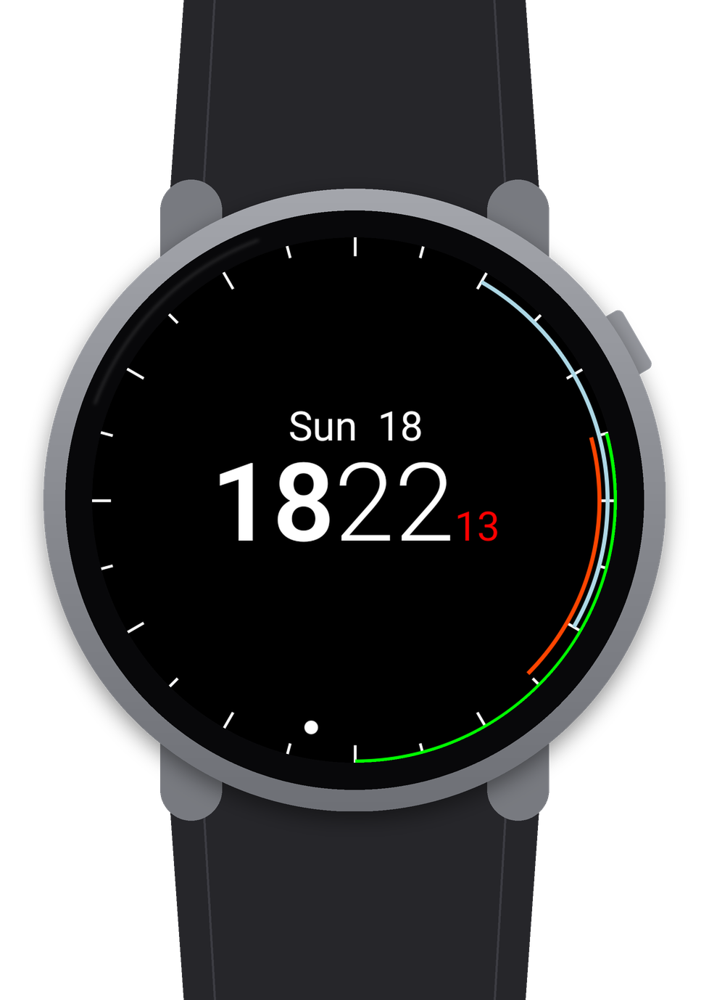
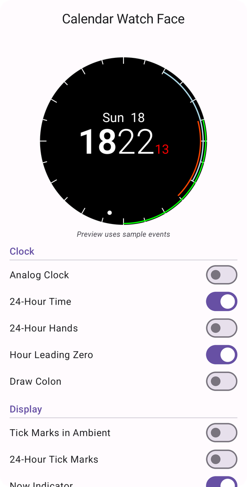

# Calendar Watch Face

A Wear OS watch face that shows your day's **Google Calendar** events as colored bands around the dial, with a companion Android phone app for settings.

It's inspired by the watch face that came with the **Outlook** app for Wear OS, which drew your meetings around the edge of the clock so you could see the shape of your day at a glance. This project brings that idea to Google Calendar (or any calendar synced to your phone).

<p align="center">
  
  &nbsp;&nbsp;&nbsp;&nbsp;
  
</p>

> **Sideload only.** This watch face can't be published on Google Play. See [Why it isn't on Google Play](#why-it-isnt-on-google-play).

## Features

- **Calendar bands:** each of today's events is drawn as an arc in its calendar's color, positioned by start and end time on a 12-hour dial. Overlapping events stack onto concentric rings (up to 4).
- **Digital or analog clock** with 12/24-hour time, optional leading zero, optional colon, and a red seconds readout / second hand.
- **Tick marks, now indicator, and date** (each configurable).
- **Ambient mode:** reduced rendering, no seconds, optional white event bands, and automatic inset for OLED burn-in protection so the bands aren't shifted off the edge of the screen.
- **Companion phone app:**
  - Live preview of the watch face with your settings (using sample events)
  - Toggles for every display option and an event band thickness slider
  - Calendar picker to choose which calendars appear on the watch
  - Changes sync to the watch within seconds over the Wearable Data Layer

## How it works

```
calendar-watchface/
├── wear/     Wear OS watch face (Jetpack Watch Face library, Canvas rendering)
├── mobile/   Phone companion app (Jetpack Compose)
└── shared/   Settings and data classes used by both
```

- **Calendar data is read on the watch.** Wear OS keeps a mirror of the phone's calendar on the watch (`com.google.android.wearable.provider.calendar`), and the watch face reads today's events from it. The watch's own standard calendar provider is normally empty. The mirror uses the same calendar IDs as the phone, so the phone app's calendar picker can filter what the watch shows.
- **Settings sync from the phone.** The companion app writes settings to the Wearable Data Layer. A `WearableListenerService` on the watch stores them in DataStore, and the watch face picks them up immediately.
- Both apps share the package name `com.derekantrican.calendarwatchface`. They **must be signed with the same key** for Data Layer sync to work.

### Settings

| Section  | Setting                   | Default   |
|----------|---------------------------|-----------|
| Clock    | Analog clock              | Off       |
| Clock    | 24-hour time              | On        |
| Clock    | 24-hour hands (analog)    | Off       |
| Clock    | Hour leading zero         | On        |
| Clock    | Draw colon                | Off       |
| Display  | Tick marks in ambient     | Off       |
| Display  | 24-hour tick marks        | Off       |
| Display  | Now indicator             | On        |
| Display  | Show date                 | On        |
| Display  | Date in ambient           | Off       |
| Calendar | Show calendar events      | On        |
| Calendar | Events in ambient         | On        |
| Calendar | White events in ambient   | On        |
| Calendar | Event band thickness      | 3 px      |
| Calendar | Calendars to show         | All synced calendars |

All-day events are not shown.

## Why it isn't on Google Play

Google Play now only accepts watch faces built with the [Watch Face Format](https://developer.android.com/training/wearables/wff) (WFF), a declarative XML format that the system renders:

- Since **January 2025**, new watch faces built with the Jetpack Watch Face library (like this one) can't be published.
- Since **January 14, 2026**, they can't be installed from Play at all, and existing ones can't be updated ([announcement](https://android-developers.googleblog.com/2025/06/upcoming-changes-to-wear-os-watch-faces.html)).

Porting to WFF isn't an option for this design. WFF allows no custom code, so a watch face can't query the calendar or lay out an arbitrary number of events as concentric rings. WFF also requires Wear OS 4 or newer.

So the only way to install this watch face is **sideloading over ADB**. That works on Wear OS 2 and 3 watches. Newer Wear OS versions may block non-WFF watch faces even when sideloaded.

## Requirements

- A round Wear OS watch on Android 8.0+ (API 26), Wear OS 2 or 3. Developed and tested on a Moto 360 (2019).
- An Android phone paired to the watch, with your Google account's calendars syncing.
- Android SDK with `adb`, and JDK 17. The JDK bundled with Android Studio works.

## Build

```sh
./gradlew :wear:assembleDebug :mobile:assembleDebug
```

APKs are written to:

- `wear/build/outputs/apk/debug/wear-debug.apk`
- `mobile/build/outputs/apk/debug/mobile-debug.apk`

Build both on the same machine so they're signed with the same debug key. Otherwise settings won't sync.

## Install

### 1. Phone app

With the phone connected over USB (USB debugging enabled):

```sh
adb install -r mobile/build/outputs/apk/debug/mobile-debug.apk
```

Open **Calendar Watch Face** on the phone and grant calendar access.

### 2. Watch face

1. On the watch, enable developer options: **Settings → System → About → tap Build number 7 times**.
2. In **Settings → Developer options**, turn on **ADB debugging** and **Debug over Wi-Fi**. Put the watch on the same Wi-Fi network as your computer, and note the address it shows (for example `192.168.0.82:5555`).
3. Connect and accept the prompt on the watch:
   ```sh
   adb connect 192.168.0.82:5555
   ```
4. Install, and grant calendar access (the watch face has no UI to ask for it):
   ```sh
   adb -s 192.168.0.82:5555 install -r wear/build/outputs/apk/debug/wear-debug.apk
   adb -s 192.168.0.82:5555 shell pm grant com.derekantrican.calendarwatchface android.permission.READ_CALENDAR
   ```
5. Long-press the current watch face, scroll to **Calendar Watch Face**, and select it.

> **Tip:** Reinstalling resets the watch to its default face. On Wear OS 2 you can switch back without touching the watch:
> ```sh
> adb -s 192.168.0.82:5555 shell am broadcast -a com.google.android.wearable.app.DEBUG_SURFACE \
>   --es operation set-watchface --ecn component com.derekantrican.calendarwatchface/.CalendarWatchFaceService
> ```

## Known issues

- **Events that cross midnight** (for example sleep from 22:30 to 06:30) draw as a full ring instead of being clipped to the dial, and can hide other events on the same ring.
- **The phone app doesn't save its settings.** Each launch starts from defaults with all calendars selected. The watch keeps the last settings it received until you change something.
- The watch face picker may show a blank preview thumbnail for this face.